# AegisCeptor | Releases

Official installer for **AegisCeptor** on macOS (Apple Silicon, M1 and newer).
mitmproxy and the bridge are bundled inside the app: no Homebrew, Node or Python needed.

Website: **[aegisceptor.com](https://aegisceptor.com)** · Created by **Prontera Labs**.

**Try it free for 14 days**, then buy a license at [aegisceptor.com](https://aegisceptor.com/#pricing):
**Lifetime** ($25, 1 Mac) or **Yearly** ($15 for 1 year of use, 1 Mac, no auto-renewal).

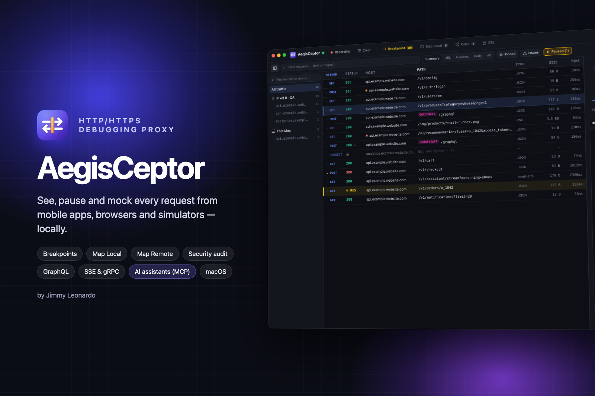

**New in 2.3:** licenses bought through Creem, a reminder 14 days before a Yearly license ends, and a clearer
Map Local rule list that shows the full path.

**New in 2.0.2:** Map Local works like Mockoon: route parameters in URL patterns (`api.myapp.com/users/:id`),
conditions on a route parameter, a **!** button to invert a condition, `{{urlParam 'id'}}` in responses, and a
⚑ default response used when no condition matches.

**New in 2.0:** signed and notarized by Apple: download, drag to Applications, open. No Terminal step needed.

**Since 1.4:** 14-day free trial and license keys. The toolbar shows the days left; activate your key in **About**.

**Since 1.3:** automatic updates, bug reports with masked secrets, a waterfall timeline, alerts when a request
fails, repeat a request N times, and OpenAPI generation plus API change detection from captured traffic.

**Since 1.2:** connect AI assistants (Claude Code, Codex CLI, Antigravity, Claude Desktop, Cursor…) through MCP in one
click, session files, Copy as cURL / fetch / Python / Swift / Kotlin, WebSocket breakpoints and a native macOS menu bar.

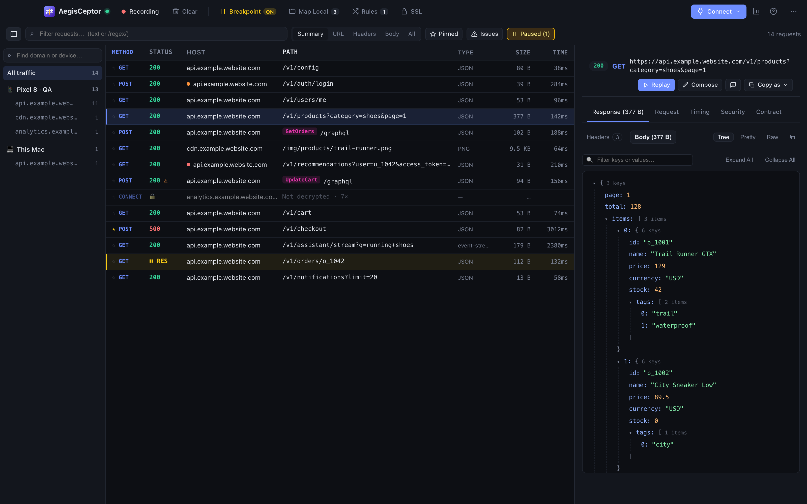

## Screenshots

| | |
|---|---|
| **Breakpoints** – pause a response and edit it before it reaches the app<br>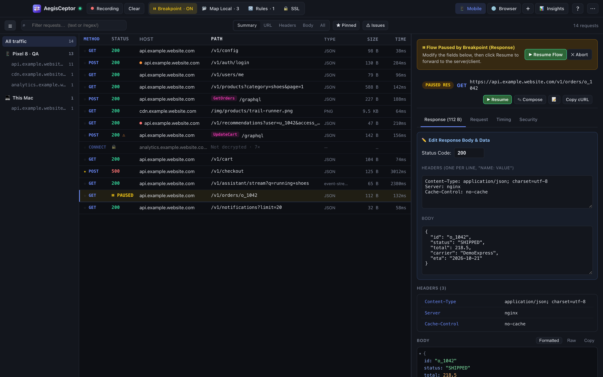 | **Map Local** – mock responses, grouped into folders<br>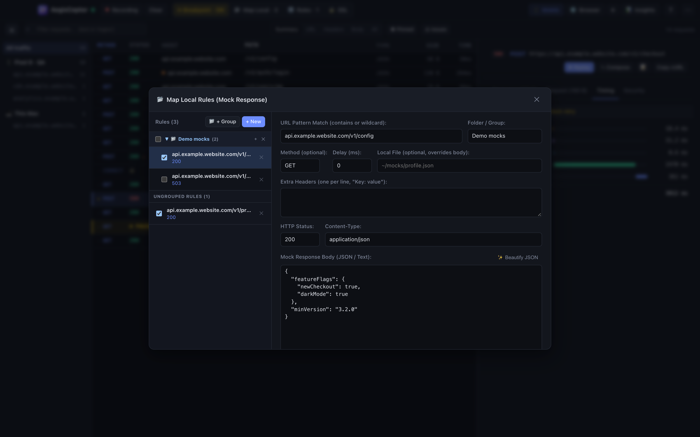 |
| **GraphQL** – operation names and errors, even on HTTP 200<br>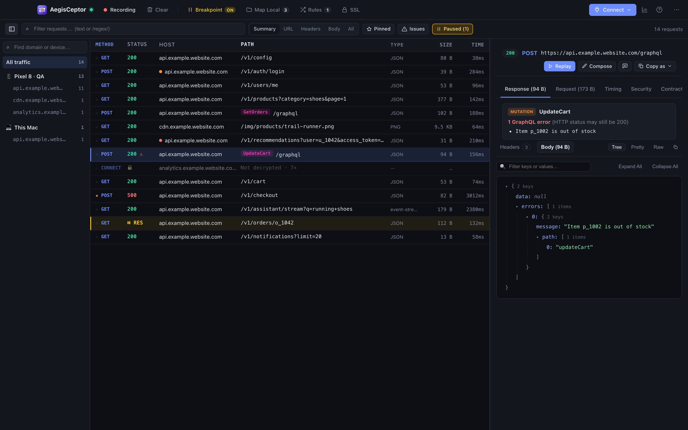 | **Security** – hints such as secrets in URLs<br>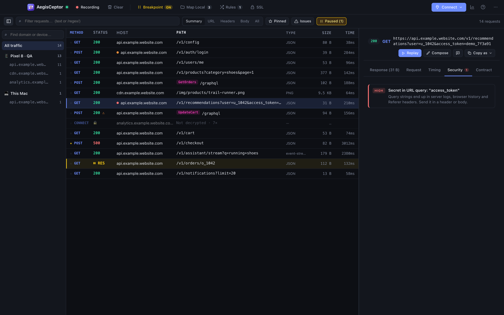 |
| **Streaming (SSE)** – every event with its arrival time<br>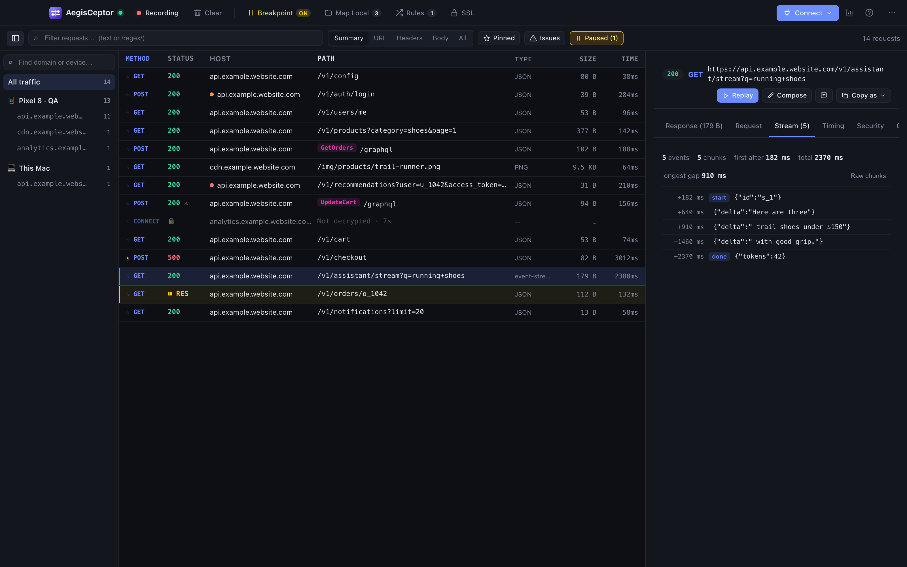 | **Timing** – connect, TLS, waiting and download per request<br>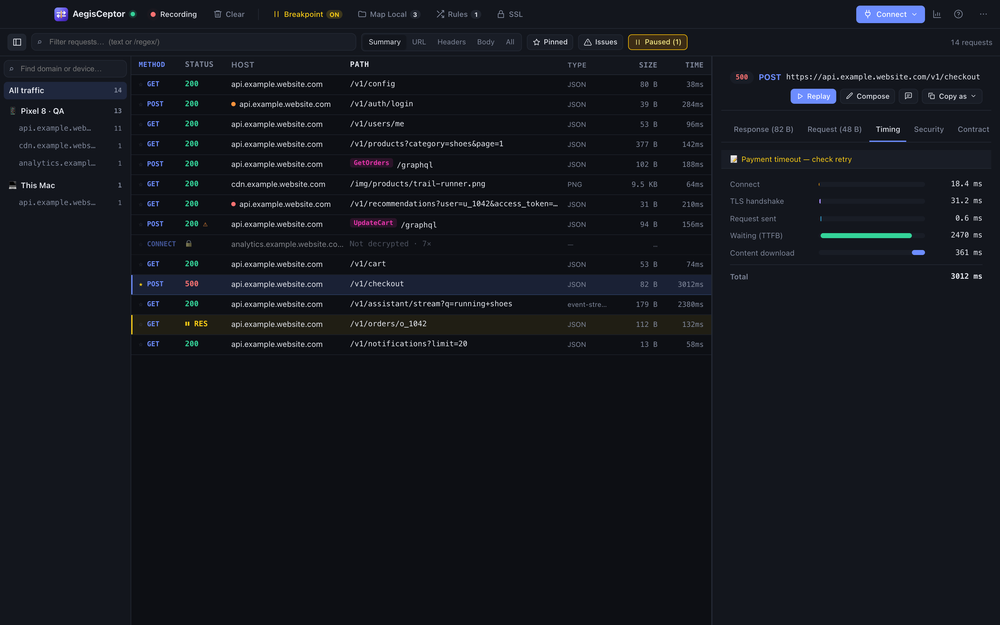 |
| **Insights** – error rate, latency, slowest and largest requests<br>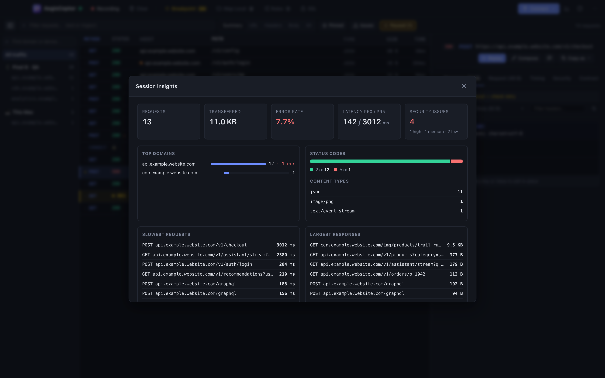 | **Light theme**<br>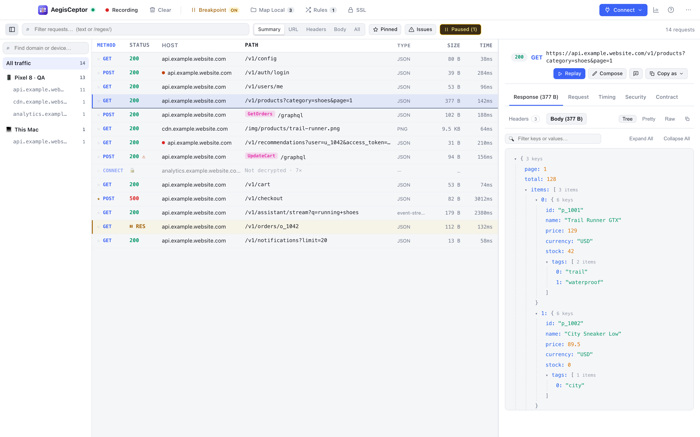 |
| **Connect** – phone, browser, iOS Simulator / Mac app, Android Emulator or terminal from one menu<br>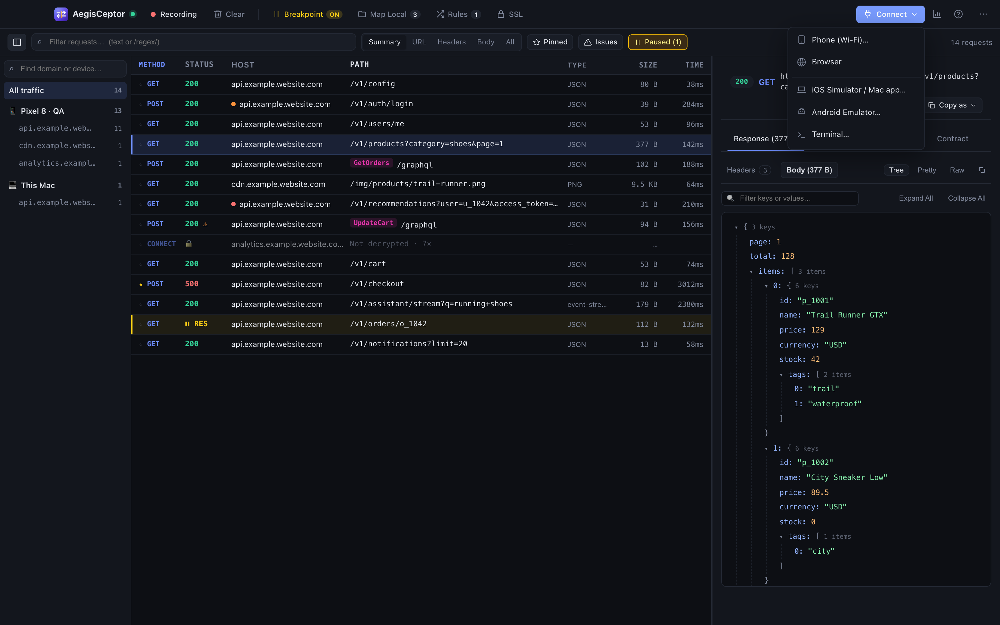 | **AI assistants (MCP)** – let your own AI assistant read traffic and create mocks; no API key needed<br>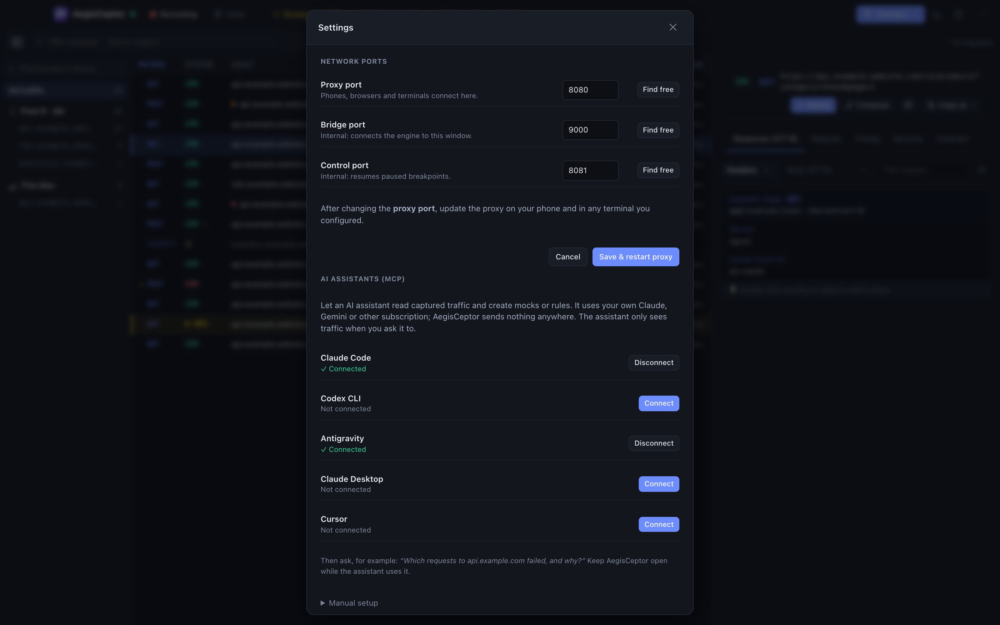 |

## Install

1. Download **[AegisCeptor.dmg](https://aegisceptor.com/download)** (always the latest version).
2. Open it and drag **AegisCeptor** into **Applications**.
3. Open AegisCeptor. The app is signed and notarized by Apple, so macOS opens it without extra steps.

The app updates itself: click **Install & restart** when it tells you a new version is available.

Prefer Terminal? This does the same in one line:

```bash
curl -fsSL https://raw.githubusercontent.com/jimmyleonardo/aegis-ceptor-releases/main/install.sh | bash
```

## License key

During the trial the toolbar shows how many days are left. To activate a license:

1. Buy one at [aegisceptor.com](https://aegisceptor.com/#pricing). The key is sent to your email.
2. In the app, open **⋯ → About AegisCeptor**, paste the key and click **Activate**.

To move a license to another Mac, click **Deactivate on this Mac** in About first, then activate it on the new Mac.

## Data

Rules are stored in `~/Library/Application Support/id.aegis-sentinel.ceptor/` and the CA certificate in `~/.mitmproxy/`.
Both are kept when you update or reinstall the app.

## Uninstall

If you connected AI assistants, click **Disconnect** for each one first (**⋯ → Settings → AI assistants (MCP)**).

```bash
rm -rf /Applications/AegisCeptor.app
# optional: also remove rules and the CA certificate
rm -rf ~/Library/Application\ Support/id.aegis-sentinel.ceptor ~/.mitmproxy
```

## License

AegisCeptor is free to try for 14 days. After that it needs a license key, valid for personal and commercial work. See [LICENSE](LICENSE) for the terms
(no resale, no modified redistribution, no warranty). Bundled open-source components are listed in
[THIRD_PARTY_NOTICES.md](THIRD_PARTY_NOTICES.md).

---

Made by Prontera Labs · [aegisceptor.com](https://aegisceptor.com) · admin@pronteralabs.id
