# AegisCeptor

**The HTTP/HTTPS debugging proxy made for Mac.** See, pause, edit and mock every request from mobile apps,
browsers and simulators, and check the Firebase and Google Analytics events they send. Built for developers and
QA engineers.

**[aegisceptor.com](https://aegisceptor.com)** · [Download](https://aegisceptor.com/download) ·
[Pricing](https://aegisceptor.com/#pricing) · [FAQ](https://aegisceptor.com/#faq) · by **Prontera Labs**

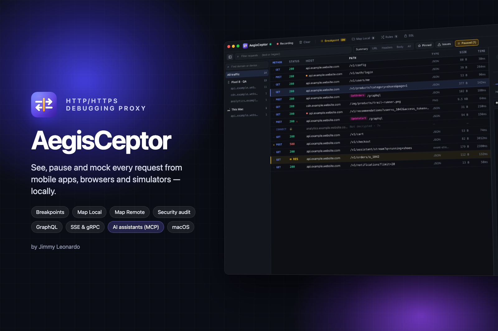

- **14 days free**, every feature, no account or card needed.
- **macOS 12 or newer** on Apple Silicon (M1 and newer).
- **Signed and notarized by Apple.** Download, drag to Applications, open. No Homebrew, Node, Python or Terminal steps.
- **Your Mac's proxy settings are never changed.** Closing the app never leaves a dead network behind.

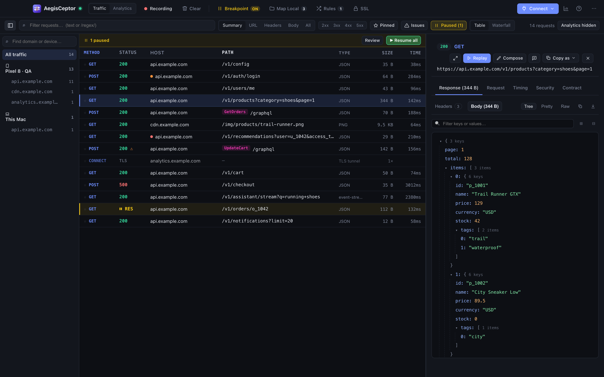

## Features

### Inspect

- **Live traffic** from phones, browsers, simulators and terminals, grouped by device and domain, with filters and sortable columns.
- **Body viewers** for JSON (tree, pretty, raw), form data, images, GraphQL, Protobuf, gRPC and MessagePack.
- **Search everywhere** in URLs, headers and bodies, or inside one body with highlighted matches.
- **Timing and waterfall**: connect, TLS, waiting and download per request, plus a timeline of the whole page or screen.
- **WebSockets and Server-Sent Events**, every message with the time it arrived.
- **Insights**: error rate, p50/p95 latency, top domains, and the slowest and largest requests.

### Pause and edit

- **Breakpoints** on requests and responses: change the method, URL, status, headers or body, then resume or abort.
- **WebSocket breakpoints**: hold a message, edit it, then send or drop it.
- **Compose and repeat**: edit and resend any request, or repeat it N times to measure p50/p95.

### Mock and change traffic

- **Map Local**: answer a URL with your own response from text or a file, with templates (uuid, now, faker…).
  One URL can hold several responses picked by conditions (query, header, body, route parameter…), and you switch
  the default in one click while your app keeps running.
- **Map Remote**: send production calls to localhost or a staging server.
- **Rewrite and Block**: set or remove headers, replace body text, change the status, or block a request.
- **Throttle and Chaos**: 3G, 4G or Edge, random latency, server errors and dropped connections.
- **OpenAPI / Swagger**: generate mocks from a spec and check live responses against it.
- **Scripts**: Python rules for anything the built-in rules cannot do.
- **Apply without closing**: rule windows apply changes with **Apply** or **⌘S**, and on/off switches apply right away.

### Check analytics events

- **Firebase and Google Analytics 4** events in one live list, with every parameter and user property, filters,
  search and a summary per event.
- **Android** (phone or emulator): events are read from the device log over adb. No proxy or certificate to set
  up, and Firebase debug mode turns on in one click.
- **iOS**: events from an iPhone on the same Wi-Fi, or open your app in the Simulator with debug mode on.
- **Websites**: GA4 and the Firebase JS SDK, including server-side tagging and Google tag gateway.

### Find problems

- **GraphQL errors**: operation names, and errors even when the HTTP status is 200.
- **Security hints**: secrets in URLs, insecure cookies, risky CORS and missing security headers.
- **Alerts**: a macOS notification when a request you watch fails or gets slow.
- **API from traffic**: build an OpenAPI spec from captured traffic and see what changed in the API.
- **Compare** any two requests side by side.

### AI assistants (MCP)

- **One-click connect** for Claude Code, Codex CLI, Antigravity, Claude Desktop, Gemini CLI, Cursor, VS Code and Windsurf.
- Your assistant reads captured traffic, explains failures and creates mocks, rewrites and breakpoints. It cannot
  resume a paused request or delete traffic. It uses your own AI subscription, so there is no API key.

### Connect

- **Phone over Wi-Fi** (Android and iOS): set the shown proxy and install the certificate by scanning a QR code.
- **Browser**: a ready-made Chrome window, or the **Chrome extension** for your everyday browser
  ([download](https://aegisceptor.com/aegisceptor-chrome-extension.zip)).
- **iOS Simulator and Mac apps, Android Emulator, terminal** (curl, Node, Python, git).
- **HTTPS your way**: decrypt everything or only the hosts you choose.

### Share

- **Sessions and HAR**: save requests, rules, comments and highlights in one file, or export and open HAR for
  everything, one device or domain, or a single request.
- **Export and import rules**: share one rule, a folder or a whole set with the files it uses. Import shows what
  already exists and lets you replace or keep both.
- **Copy as code**: cURL, JavaScript fetch, Python requests, Swift URLSession and Kotlin OkHttp.
- **Bug reports** ready to paste, with tokens and passwords masked.

## Screenshots

| | |
|---|---|
| **Analytics** – Firebase and GA4 events from Android, iOS and the web<br>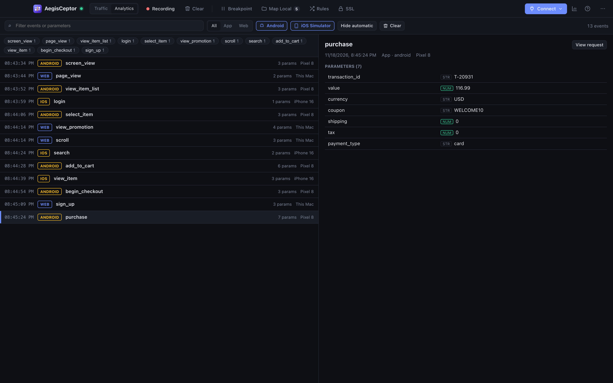 | **Map Local** – several responses per URL, export and import<br>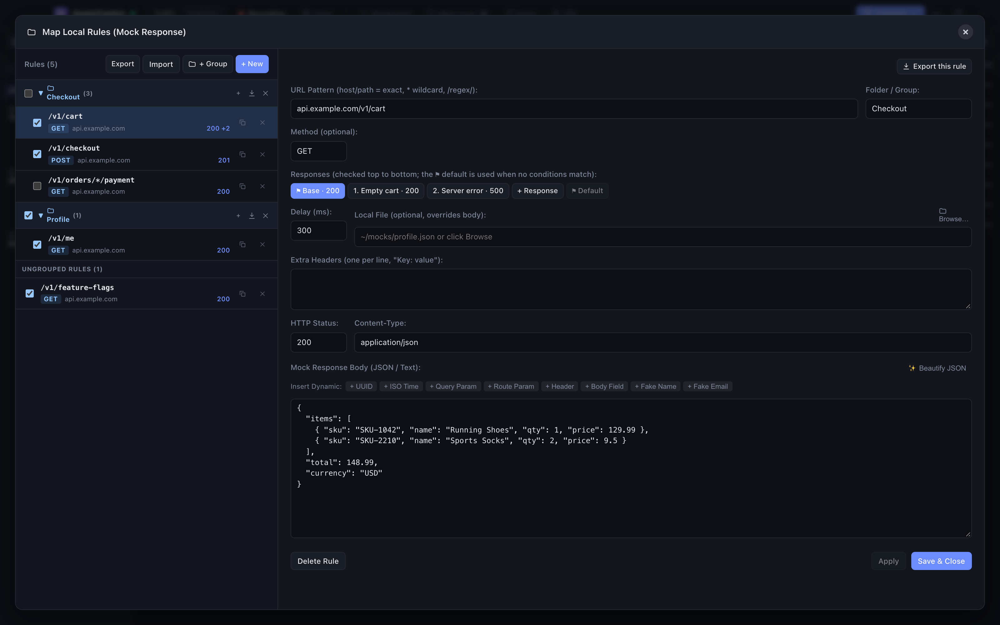 |
| **Breakpoints** – pause a response and edit it before it reaches the app<br>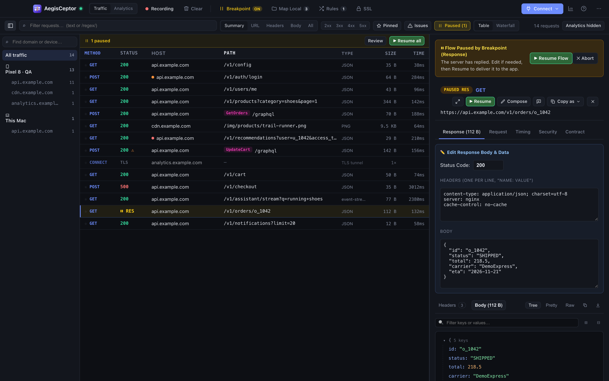 | **GraphQL** – operation names and errors, even on HTTP 200<br>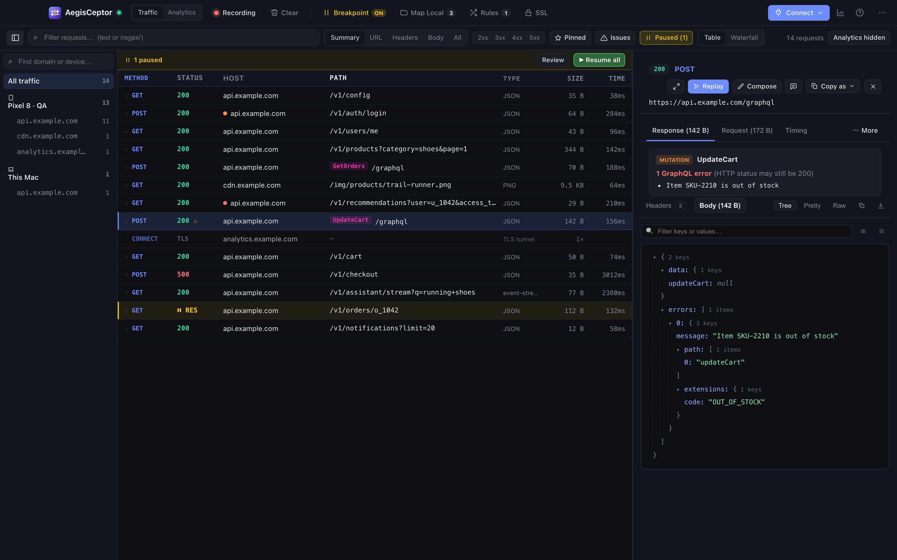 |
| **Security** – hints such as secrets in URLs<br>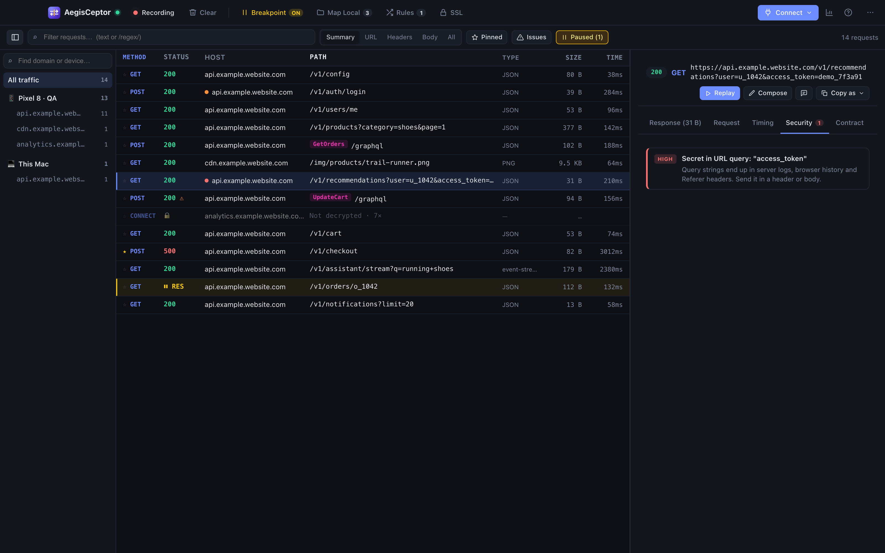 | **Streaming (SSE)** – every event with its arrival time<br>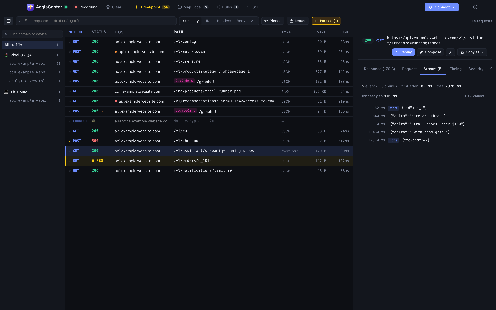 |
| **Timing** – connect, TLS, waiting and download per request<br>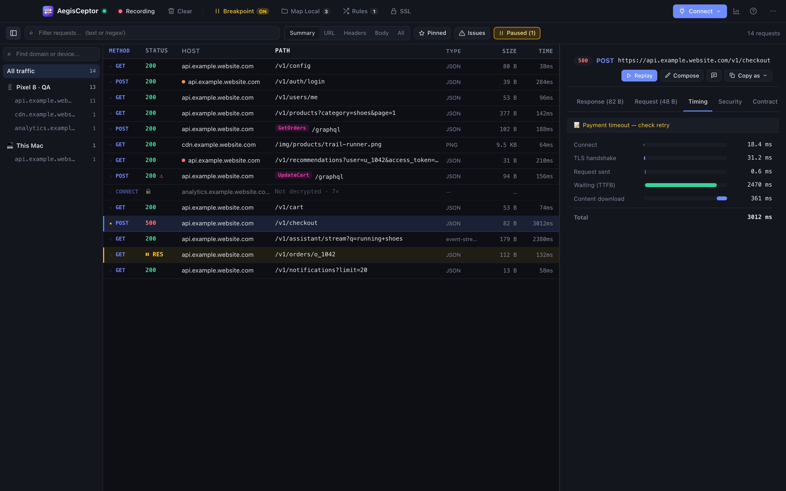 | **Insights** – error rate, latency, slowest and largest requests<br>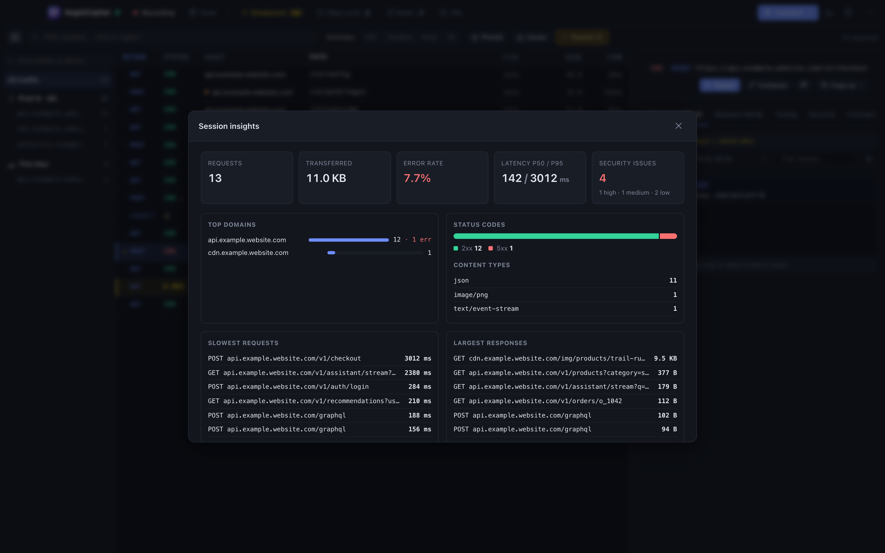 |
| **Connect** – phone, browser, iOS Simulator / Mac app, Android Emulator or terminal from one menu<br>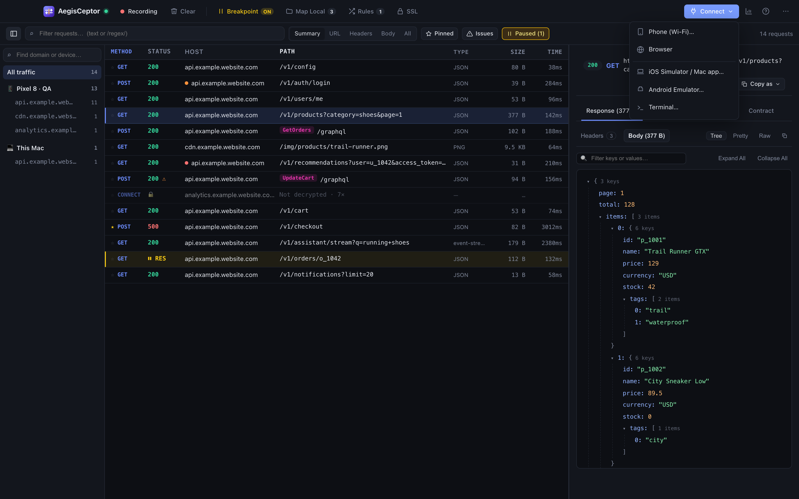 | **AI assistants (MCP)** – your own AI assistant reads traffic and creates mocks<br>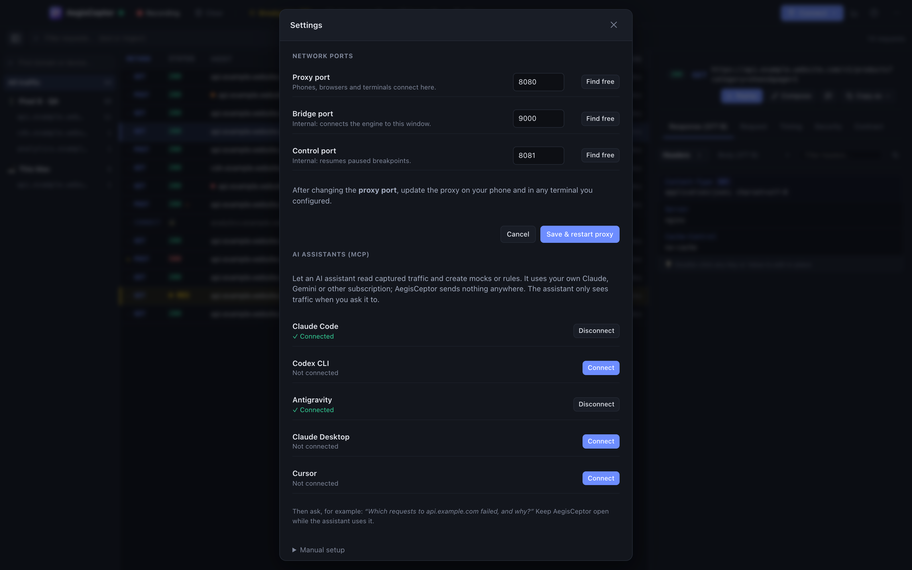 |
| **Light theme**<br>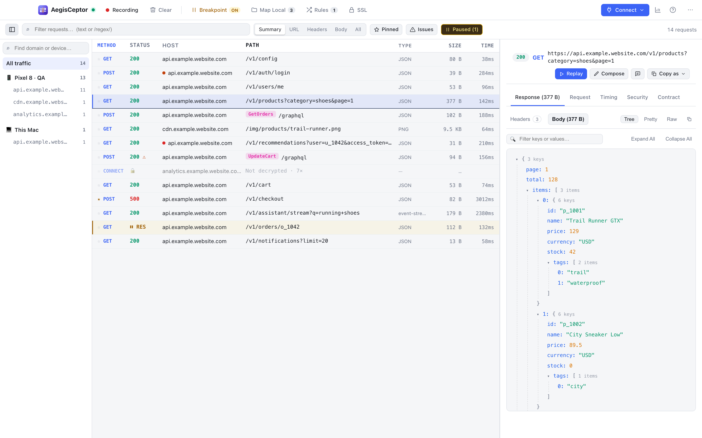 | |

A one-minute demo video is on [aegisceptor.com](https://aegisceptor.com/#demo).

## Install

1. Download **[AegisCeptor.dmg](https://aegisceptor.com/download)** (always the latest version).
2. Open it and drag **AegisCeptor** into **Applications**.
3. Open AegisCeptor. The app is signed and notarized by Apple, so macOS opens it without extra steps.

The app updates itself: click **Install & restart** when it tells you a new version is available.

Prefer Terminal? This does the same in one line:

```bash
curl -fsSL https://raw.githubusercontent.com/jimmyleonardo/aegis-ceptor-releases/main/install.sh | bash
```

## License key

Try every feature free for 14 days. During the trial the toolbar shows how many days are left.

1. Buy a license at **[aegisceptor.com/#pricing](https://aegisceptor.com/#pricing)**: **Lifetime** ($25, 1 Mac) or
   **Yearly** ($15 for 1 year of use, 1 Mac, no auto-renewal). You get the license key after checkout.
2. In the app, open **⋯ → About AegisCeptor**, paste the key and click **Activate**.

To move a license to another Mac, click **Deactivate on this Mac** in About first, then activate it on the new Mac.

## Data

Everything stays on your Mac. Rules are stored in `~/Library/Application Support/id.aegis-sentinel.ceptor/` and
the CA certificate in `~/.mitmproxy/`. Both are kept when you update or reinstall the app.

## Uninstall

If you connected AI assistants, click **Disconnect** for each one first (**⋯ → Settings → AI assistants (MCP)**).

```bash
rm -rf /Applications/AegisCeptor.app
# optional: also remove rules and the CA certificate
rm -rf ~/Library/Application\ Support/id.aegis-sentinel.ceptor ~/.mitmproxy
```

## License

AegisCeptor is free to try for 14 days. After that it needs a license key, valid for personal and commercial work.
See [LICENSE](LICENSE) for the terms (no resale, no modified redistribution, no warranty). Bundled open-source
components are listed in [THIRD_PARTY_NOTICES.md](THIRD_PARTY_NOTICES.md).

---

Made by Prontera Labs · **[aegisceptor.com](https://aegisceptor.com)** · admin@pronteralabs.id
